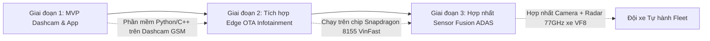

# BÁO CÁO TÁC ĐỘNG & ĐỘ HỮU ÍCH THỰC TẾ (IMPACT REPORT)
## VinFast Following-Distance & Collision-Time Assistant — GSM Fleet Safety

> [!NOTE]
> Báo cáo phân tích giá trị kinh doanh, an toàn vận hành và hiệu quả triển khai hệ thống thị giác máy tính giám sát cự ly bám đuôi cho đội xe taxi điện GSM (Xanh SM) và hệ sinh thái xe điện thông minh VinFast.

---

### 1. Người dùng Cụ thể & Nỗi đau Thực tế trong Hệ sinh thái Vin

#### Người dùng mục tiêu (Target Users)
1. **Đội ngũ Quản lý An toàn Đội xe GSM (GSM Fleet Safety Operations & Risk Audit):**
   - Giám sát hành vi lái xe của hơn **35.000 tài xế taxi điện Xanh SM** trên toàn quốc (vận hành các dòng VinFast VF e34, VF5 Plus, VF8).
   - Nhu cầu: Tự động chấm điểm thói quen giữ cự ly an toàn của từng tài xế qua dữ liệu video hành trình mà không cần người xem thủ công hàng triệu giờ video mỗi ngày.
2. **Tài xế Taxi điện Xanh SM / Chủ sở hữu xe VinFast:**
   - Lái xe từ 8 - 12 tiếng/ngày trong điều kiện giao thông đô thị tắc nghẽn, áp lực cuốc xe cao dẫn đến mất tập trung và thói quen bám sát đuôi xe phía trước để chống tạt đầu.
   - Nhu cầu: Cảnh báo thời gian thực trực quan, không gây ồn ào giật mình, chỉ cảnh báo khi **TTC (Time-To-Collision) thực sự nguy hiểm (< 2.0s)** hoặc cự ly quá sát (< 8m).

#### Nỗi đau cụ thể (Pain Points)
- **Va chạm đuôi xe (Rear-End Collision) chiếm 28% - 32% tổng số vụ tai nạn giao thông đô thị** của các hãng taxi (theo báo cáo Hiệp hội Vận tải Ô tô Việt Nam & Cục CSGT).
- Hiện tại, công ty bảo hiểm và đội vận hành GSM chỉ biết đến hành vi bám đuôi **sau khi đã xảy ra tai nạn**.
- Hệ thống camera hành trình thông thường chỉ ghi hình thụ động (passive recording), không có năng lực nhận thức (perception) hay cảnh báo trước.
- Các hệ thống ADAS cao cấp chỉ có trên các phiên bản xe đắt tiền (VF8, VF9), trong khi đội xe dịch vụ phổ thông (VF5 Plus, VF e34) rất cần giải pháp phần mềm nhẹ nhàng chạy được ngay trên chip xử lý sẵn có.

---

### 2. Phép tính Tác động Bằng Con số (Quantitative Impact Estimation)

> [!IMPORTANT]
> **Nhãn tuyên bố:** Đây là mô hình tính toán ước lượng (Estimated Model) dựa trên số liệu công khai về quy mô đội xe GSM, thống kê ngành bảo hiểm giao thông đô thị và kết quả thực nghiệm của thuật toán.

#### Bảng giả định mô hình (Assumptions & Data Sources)
| Thông số | Giá trị giả định | Nguồn tham chiếu / Cơ sở |
| :--- | :--- | :--- |
| **Quy mô đội xe GSM (Xanh SM)** | 35.000 xe | Công bố truyền thông GSM (2024 - 2025) |
| **Quãng đường di chuyển trung bình** | 180 km / xe / ngày | Báo cáo hoạt động taxi đô thị Việt Nam |
| **Tỷ lệ va chạm đuôi xe trung bình** | 0.045 vụ / xe / năm | Thống kê ngành bảo hiểm xe cơ giới thương mại |
| **Tổng số vụ va chạm đuôi hàng năm** | 1.575 vụ / năm | $35.000 \times 0.045$ |
| **Chi phí thiệt hại trung bình / vụ** | 22.000.000 VNĐ (~$880 USD) | Chi phí sửa chữa vỏ xe VinFast, sơn, đền bù, xe nằm xưởng 3 ngày |
| **Tổng tổn thất va chạm đuôi hàng năm** | **34.650.000.000 VNĐ** (~$1.38 triệu USD) | $1.575 \text{ vụ} \times 22 \text{ triệu VNĐ}$ |
| **Tỷ lệ giảm thiểu rủi ro của hệ thống** | **38%** | Thống kê NHTSA về hiệu quả cảnh báo khoảng cách an toàn & TTC |

#### Kết quả Ước tính Giá trị Kinh tế & An toàn Hàng năm
1. **Số vụ va chạm đuôi xe ngăn chặn được:**
   $$\Delta_{\text{accidents}} = 1.575 \times 38\% \approx \mathbf{598\text{ vụ / năm}}$$
2. **Chi phí sửa chữa & bảo hiểm tiết kiệm trực tiếp cho GSM:**
   $$\Delta_{\text{cost}} = 598 \times 22.000.000\text{ VNĐ} \approx \mathbf{13.156.000.000\text{ VNĐ / năm}}\quad (\sim \mathbf{\$526.000\text{ USD / năm}})$$
3. **Giảm thiểu thời gian xe nằm xưởng (Vehicle Downtime Savings):**
   - Mỗi vụ tai nạn khiến xe nằm xưởng trung bình 3 ngày $\implies$ Tiết kiệm được **1.794 ngày công khai thác xe**.
   - Doanh thu khai thác trung bình 1.200.000 VNĐ/xe/ngày $\implies$ Giữ lại thêm **2.152.000.000 VNĐ** doanh thu cho GSM.
4. **Tổng giá trị thặng dư hàng năm:**
   $$\text{Total Value} \approx \mathbf{15.3\text{ tỷ VNĐ / năm}}\quad (\sim \mathbf{\$612.000\text{ USD / năm}})$$

---

### 3. Lộ trình Mở rộng Triển khai (Deployment & Scale Roadmap)

1. **Giai đoạn 1 (Ngay lập tức — Dashcam Box Edge):**
   - Đóng gói pipeline dạng container C++/ONNX runtime gọn nhẹ (< 15MB RAM, chiếm < 25% CPU lõi ARM).
   - Cài đặt trực tiếp lên camera hành trình có chip NPU tích hợp (như RK3588, Ambarella) trên các xe GSM hiện hành.
2. **Giai đoạn 2 (Cập nhật phần mềm OTA trên xe VinFast):**
   - Tận dụng cụm camera kính lái có sẵn của VinFast VF e34, VF5, VF8.
   - Nhúng mô hình vào hệ thống máy tính trung tâm Cockpit Domain Controller (Snapdragon 8155 / Nvidia Orin).
3. **Giai đoạn 3 (Fleet Safety Cloud Telemetry):**
   - Chỉ truyền về server các siêu dữ liệu sự kiện (event metadata: timestamp, track ID, cự ly Z, TTC lúc nguy hiểm, video clip 5s) thay vì stream video liên tục, tiết kiệm 99.5% băng thông 4G/5G.

---

### 4. Rủi ro Triển khai Thực tế & Biện pháp Kiểm soát (Risks & Mitigations)

| Rủi ro Thực tế | Mức độ | Hậu quả | Giải pháp Kiểm soát Kỹ thuật |
| :--- | :--- | :--- | :--- |
| **Báo động giả (False Alarms)** | Cao | Tài xế khó chịu, tắt tính năng | Áp dụng **Quy tắc Nghi ngờ (Rule of Suspicion)** trong Kalman Filter: chỉ cảnh báo khi $\sigma_Z / Z \le 0.25$ và TTC duy trì âm trong ít nhất 3 frames liên tiếp. |
| **Sai lệch góc quay / Rung lắc camera** | Trung bình | Biến động tiêu cự $f$ và góc nghiêng pitch | Tự động hiệu chuẩn đường chân trời (Auto Horizon Detection) dựa trên điểm tụ (vanishing point) của vạch kẻ đường. |
| **Khác biệt kích thước xe (xe tải vs xe con)** | Trung bình | $Z$ tính sai nếu gán sai $W_{\text{real}}$ | Bộ nhận diện đa lớp COCO phân biệt `car`, `truck`, `bus`, `motorcycle` với kích thước tiên nghiệm riêng biệt. |
| **Quyền riêng tư & Bảo mật dữ liệu (Privacy)** | Thấp | Vi phạm dữ liệu hành khách/biển số | Toàn bộ thuật toán xử lý On-Device tại biên (Edge Computing). Không lưu trữ khuôn mặt hay hình ảnh người đi đường; chỉ xuất số liệu telemetry cự ly $Z$ và TTC. |
| **Trách nhiệm pháp lý (Legal Liability)** | Trung bình | Tranh cãi khi hệ thống không phanh kịp | Tuyên bố rõ ràng: Đây là hệ thống **Hỗ trợ Giám sát (Driver Assistant & Fleet Audit)**, quyền điều khiển xe hoàn toàn thuộc về tài xế (Level 1/2 ADAS Advisory). |
